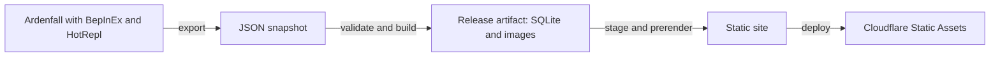

# Ardenfall Compendium

Ardenfall Compendium is an interactive map and searchable reference for players of Ardenfall by Spellcast Studios. It uses the game's own data to connect items, characters, quests, dialogue, spells, and world locations. This is an unofficial fan project that Spellcast Studios does not make or endorse.

[Open the compendium](https://ardenfall.compendiums.org/)

## Use the compendium

- Explore the map to find world objects, characters, resources, and locations.
- Browse or search reference pages for equipment, spells, status effects, quests, and other game records.
- Follow relationships between pages to find dialogue, rewards, drops, and placed objects.

The site identifies the game build behind its data and marks missing or ambiguous information instead of guessing. You do not need a game installation to browse it. Use this repository to change the site or rebuild its data.

## Setup

The website and pipeline need Bun and Node. [`package.json`](package.json) declares the Bun requirement, and [`flake.nix`](flake.nix) defines the development toolchain, including the .NET SDK needed for the extraction mod.

On a supported Nix system:

```sh
nix develop
bun install --frozen-lockfile
```

Without Nix, install the required tools and run the same dependency command. The live extraction scripts also need Bash.

### Run the website with fixture data

From the repository root:

```sh
bun run artifact:fixture synthetic fixtures/synthetic/snapshot
bun run --cwd site build:fixture
bun run dev
```

This builds a synthetic artifact and stages it for local development. You can change the website without a game installation. Fixture data is not a copy of the published compendium and cannot be deployed as production data.

To preview the built fixture site:

```sh
bun run --cwd site preview
```

## Extract game data



The BepInEx mod reads live game objects and writes a snapshot. The Bun pipeline validates the snapshot and produces the database, images, and metadata used to build the SvelteKit site. The browser receives static pages and assets, not a live game connection or the build database.

Live extraction needs a local main-game Ardenfall installation, BepInEx, the .NET SDK, and a [HotRepl](https://github.com/glockyco/HotRepl) checkout. Demo and unknown products are rejected as publication sources.

Start with the local configuration template:

```sh
cp .env.example .env
```

Fill in your paths and connection settings using [`.env.example`](.env.example), then follow the [live-extraction procedure](.omp/skills/live-extraction/SKILL.md). It covers installing BepInEx, building and deploying the mod, launching the game, and running `bun run hotrepl:export`. Keep the runtime connection on loopback because it permits unauthenticated code execution. Back up saves before probes that change game state.

The setup writes plugins and HotRepl configuration into the game installation. Export and pipeline output locations come from your local configuration. Keep game assemblies, live snapshots, and extracted assets out of Git.

## Build and publish a release

Commit your source changes before building the release artifact. Production staging rejects an artifact recorded from a dirty tree. With the default configuration, the export writes each snapshot below `snapshots/snapshots/`. From the repository root:

```sh
bun run artifact:release snapshots/snapshots/<snapshot-id>
```

The pipeline writes the artifact to `pipeline/artifacts/releases/`, in a directory named from the snapshot's game version and build identifier, and reports that directory. Use it in the deployment command below. Production staging requires a release artifact and its `artifact-manifest.json`. `site/static` is a staging cache that deployment fills from the artifact, so change the pipeline or the site source instead of files there.

Authenticate Wrangler through the site's dependency:

```sh
cd site
bunx wrangler login
cd ..
```

Deploy from the repository root:

```sh
bun run --cwd site deploy:production ../pipeline/artifacts/releases/<game-version>-<build-identifier>
```

This stages the artifact in the release slot, builds the pages and search index, runs the prerender and search checks, publishes static files to Cloudflare, and checks the deployed release. The private build database is not deployed. Fixture and release staging slots are separate, so fixture builds do not overwrite the staged live data.

[`site/AGENTS.md`](site/AGENTS.md#deployment) explains staging, preview selection, and deployment rules. [`pipeline/src/cli.ts`](pipeline/src/cli.ts) defines artifact commands and output naming.

## Change the project

Start with [`AGENTS.md`](AGENTS.md) for the development checks and live-data verification requirements. It links the subsystem guides and lists the full gate. The usual entry points are:

- [`mod/`](mod/) for the extraction plugin and [`controller/`](controller/) for HotRepl setup and export automation.
- [`pipeline/`](pipeline/) for validation, canonical data, and artifact generation.
- [`site/`](site/) for pages, search, the map, and deployment.
- [`entities/`](entities/) and [`schemas/`](schemas/) for entity descriptors and data contracts.
- [`openspec/specs/`](openspec/specs/) for behavior requirements.

The fixture workflow above exercises the site without live data. It does not prove that extraction matches the game. Read the [live-extraction procedure](.omp/skills/live-extraction/SKILL.md) before changing export behavior or using runtime probes.

## License

The code is licensed under the [MIT License](LICENSE). The license does not cover Ardenfall's game data, text, names, or images, which belong to Spellcast Studios.
